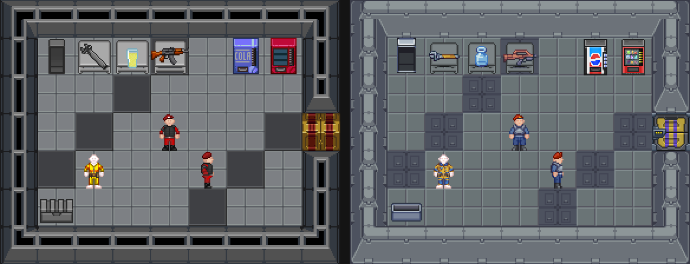

# CEV-Eris reskin

Converts CEV-Eris sprites (BYOND `.dmi`) into the SS14 RSIs and textures Oxyd14 inherits from
upstream, so the game looks like CEV-Eris without changing entity prototypes or maps.

The art is written **into the existing RSIs, keeping every state name, direction count and
unmapped state**. Visualizers, `IconSmooth`, clothing slots and anything else that refers to a
sprite keep working. New upstream art arriving in a merge is simply re-covered by running the
tool again.



## Running it

```sh
git clone https://github.com/discordia-space/CEV-Eris ../CEV-Eris
Tools/eris_reskin/regen.sh ../CEV-Eris               # regenerate every map, rebuild every texture
python3 Tools/eris_reskin/coverage.py --md Tools/eris_reskin/COVERAGE.md
python3 Tools/eris_reskin/standins.py                # refresh STANDINS.md
```

`regen.sh` restores the reskinned texture folders from the upstream commit in `BASE` first,
so a rebuild never stacks on top of an earlier one. Python 3 with Pillow and PyYAML is needed.
After merging a new upstream, update `BASE` to the merged upstream commit and re-run it.

## How it works

| File | Role |
|---|---|
| `dmi.py` | Reads DMI sheets: states, directions, frames, delays |
| `catalog.py` | Parses Eris's DM type tree and resolves each item's icon, worn and in-hand sprites (mirrors `update_icons.dm`) |
| `match.py` | Name tokens with SS14-to-Eris synonyms (security -> ironhammer, ...), colour signatures, greedy assignment that avoids reusing one Eris sprite everywhere |
| `build.py` | Applies `maps/*.json` to `Resources/Textures` |
| `gen_ui.py` | HUD theme, alerts, HUD icons, radial menu, window chrome |
| `gen_clothing.py` | Clothing, matched per equipment slot; `clothing_overrides.json` pins job outfits |
| `gen_objects.py` | Objects, structures and mobs, matched by folder-specific pools; `*_overrides.json` pins picks |
| `gen_smoothing.py` | Walls, windows and tables: SS14 corner states built from Eris art |
| `gen_doors.py` | Airlocks, firelocks, blast doors, shutters, windoors, material doors |
| `gen_tiles.py` | Floor tile textures |
| `gen_mobs.py` | Human body parts (colour-matched for skin tones), hair and facial hair |
| `gen_effects.py` | Hand-picked effects, fluids, floor markings and speech bubbles |

Outside this folder the reskin also changes:

- `Content.Client/_Oxyd/Stylesheets/ErisPalettes.cs` and `NanotrasenStylesheet.Palettes.cs`: window and
  button colours from Eris NanoUI
- `Resources/Prototypes/themes.yml`: default HUD theme colours
- `Resources/Prototypes/lobbyscreens.yml` and `Textures/LobbyScreens/eris_*.webp`: Eris title screens

## Coverage

See `COVERAGE.md` (generated). Not covered, because Eris has no art for them:

- Non-human species bodies and their markings (Eris only has humans)
- Clothing states drawn for those species (they keep SS14 art)
- Small overlays such as reagent fill levels and machine lights where Eris art differs in shape
- Interface glyph icons (emotes, admin tools, map markers) and the optional non-default UI themes
- Tile edge overlays for planet terrain, liquids and chasms

Every pick that is not a true Eris equivalent is listed in `STANDINS.md`.

## Licence

CEV-Eris has no separate art licence; its `COPYING` puts the repository under AGPLv3, while
much of its art originates from Baystation12/tgstation, which publish art under CC-BY-SA 3.0.
Reskinned RSIs are marked CC-BY-SA-3.0 with CEV-Eris credited in `copyright`. Confirm this with
the CEV-Eris maintainers before distributing.
